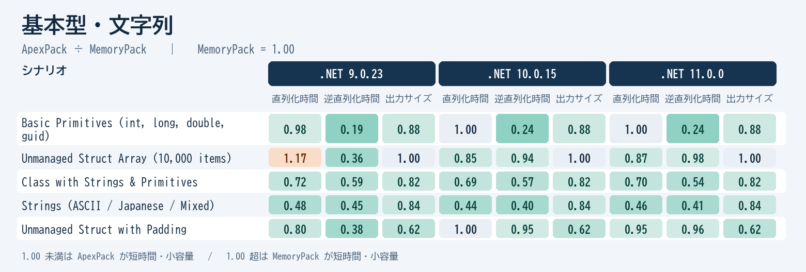
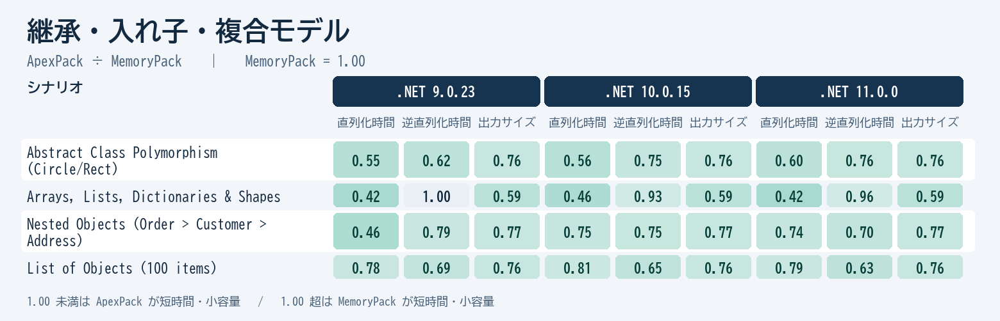
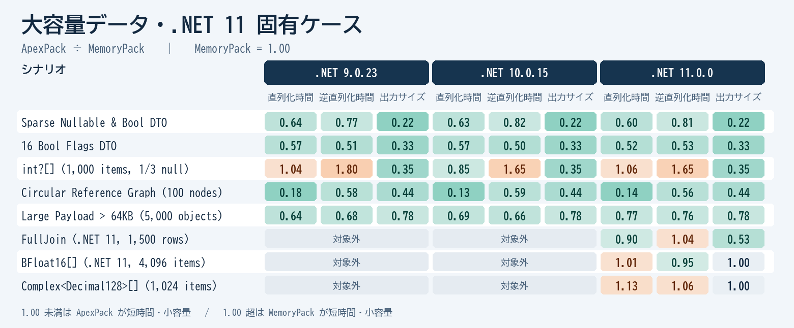
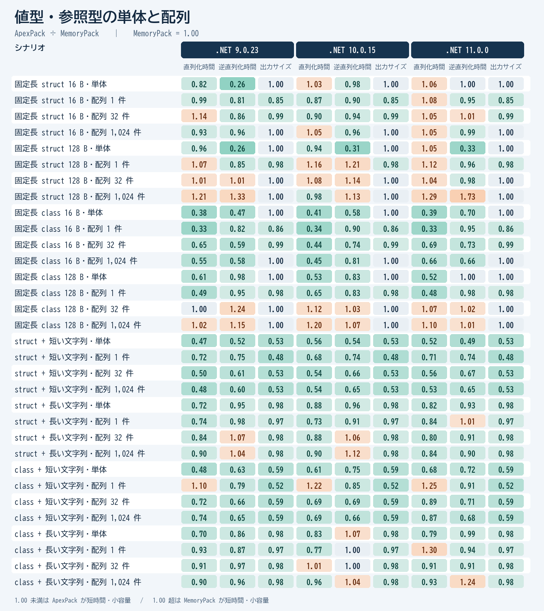
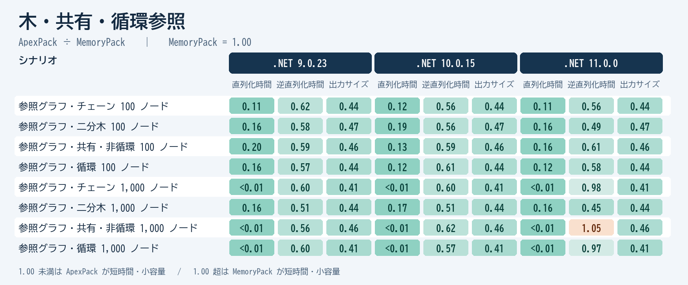
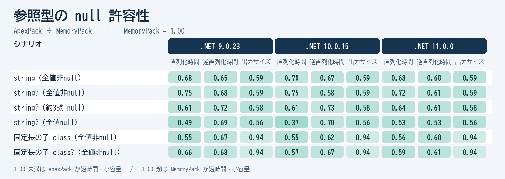

# ApexPack

.NET 向けのバイナリシリアライザーです。

- [C# ファイル1本の実行例](docs/examples/QuickStart.cs)
- [性能とデータサイズのインフォグラフィック](docs/performance.md)
- [ワイヤ形式](docs/WireFormat.md)

.NET 10 SDK 以降の環境で、チェックアウトのルートから実行例を試せます。

```sh
dotnet run --file docs/examples/QuickStart.cs
```

## 性能とデータサイズのインフォグラフィック

全87シナリオを、行にシナリオ、列に .NET バージョンと測定項目を置いて並べました。数字は **ApexPack ÷ MemoryPack** です。1.00未満なら ApexPack の処理時間が短い、または出力が小さいことを示します。

<details open>
<summary>基本型・文字列</summary>



</details>

<details>
<summary>継承・入れ子・複合モデル</summary>



</details>

<details>
<summary>大容量データ・.NET 11 固有ケース</summary>



</details>

<details>
<summary>値型・参照型の単体と配列</summary>



</details>

<details>
<summary>配列・リスト・辞書</summary>


</details>

<details>
<summary>木・共有・循環参照</summary>



</details>

<details>
<summary>参照型の null 許容性</summary>



</details>

[性能とデータサイズのインフォグラフィック](docs/performance.md) · [実測値と割り当て量の全件CSV](docs/data/runtime-benchmarks.csv)

<!-- benchmark-results:begin -->
## MemoryPack との比較結果

各セルは **ApexPack / MemoryPack** の順です。処理時間と割り当て量は1回あたりです。

| ランタイム | シナリオ | 直列化 ns | 逆直列化 ns | 出力 B | 直列化割当 B | 逆直列化割当 B |
| --- | --- | ---: | ---: | ---: | ---: | ---: |
| .NET 9.0.23 | `LinkedList<int>`、1,024要素 | 1,893.4 / 7,976.8 | 10,240.4 / 9,905.4 | 4,099 / 4,100 | 4,128 / 4,128 | 49,192 / 49,192 |
| .NET 9.0.23 | `SortedDictionary<int, int>`、1,024件 | 8,435.5 / 8,505.7 | 43,052.3 / 45,134.8 | 8,195 / 8,196 | 8,440 / 8,440 | 49,264 / 49,264 |
| .NET 9.0.23 | 共有参照、1,000ノード | 48,200.0 / 15,652,900.0 | 35,033.3 / 62,833.3 | 13,496 / 29,477 | 13,520 / 127,705,320 | 80,000 / 80,000 |
| .NET 9.0.23 | 循環参照、1,000ノード | 26,866.7 / 8,777,366.7 | 30,600.0 / 51,366.7 | 11,001 / 26,734 | 11,032 / 127,702,576 | 80,000 / 80,000 |
| .NET 9.0.23 | `string`、全値非null | 9,899.6 / 14,589.8 | 13,609.2 / 20,868.0 | 10,243 / 17,412 | 10,272 / 17,440 | 73,752 / 73,752 |
| .NET 9.0.23 | `string?`、全値非null | 10,198.1 / 13,510.5 | 13,830.9 / 20,337.9 | 10,243 / 17,412 | 10,272 / 17,440 | 73,752 / 73,752 |
| .NET 9.0.23 | 固定長の子クラス、全値非null | 8,456.0 / 15,485.3 | 13,447.9 / 20,187.4 | 17,411 / 18,436 | 17,440 / 18,464 | 65,560 / 65,560 |
| .NET 9.0.23 | 固定長の子クラス `?`、全値非null | 9,464.2 / 14,397.8 | 13,358.9 / 19,614.1 | 17,411 / 18,436 | 17,440 / 18,464 | 65,560 / 65,560 |
| .NET 10.0.15 | `LinkedList<int>`、1,024要素 | 4,302.8 / 6,198.8 | 11,356.7 / 10,758.9 | 4,099 / 4,100 | 4,128 / 4,128 | 49,192 / 49,192 |
| .NET 10.0.15 | `SortedDictionary<int, int>`、1,024件 | 6,999.1 / 5,886.7 | 33,699.5 / 33,428.9 | 8,195 / 8,196 | 8,440 / 8,440 | 49,264 / 49,264 |
| .NET 10.0.15 | 共有参照、1,000ノード | 41,250.0 / 10,359,850.0 | 41,050.0 / 66,500.0 | 13,496 / 29,477 | 13,520 / 127,705,320 | 80,000 / 80,000 |
| .NET 10.0.15 | 循環参照、1,000ノード | 24,600.0 / 15,868,875.0 | 29,050.0 / 50,700.0 | 11,001 / 26,734 | 11,032 / 127,702,576 | 80,000 / 80,000 |
| .NET 10.0.15 | `string`、全値非null | 9,260.9 / 13,182.0 | 13,311.6 / 19,830.1 | 10,243 / 17,412 | 10,272 / 17,440 | 73,752 / 73,752 |
| .NET 10.0.15 | `string?`、全値非null | 9,399.9 / 12,553.7 | 12,812.7 / 22,017.3 | 10,243 / 17,412 | 10,272 / 17,440 | 73,752 / 73,752 |
| .NET 10.0.15 | 固定長の子クラス、全値非null | 7,129.8 / 12,958.4 | 10,895.9 / 17,695.9 | 17,411 / 18,436 | 17,440 / 18,464 | 65,560 / 65,560 |
| .NET 10.0.15 | 固定長の子クラス `?`、全値非null | 6,872.7 / 11,992.5 | 11,046.3 / 16,443.5 | 17,411 / 18,436 | 17,440 / 18,464 | 65,560 / 65,560 |
| .NET 11.0.0 | `LinkedList<int>`、1,024要素 | 3,821.2 / 5,798.9 | 10,005.2 / 9,694.4 | 4,099 / 4,100 | 4,128 / 4,128 | 49,192 / 49,192 |
| .NET 11.0.0 | `SortedDictionary<int, int>`、1,024件 | 10,080.8 / 7,426.5 | 49,371.3 / 50,808.8 | 8,195 / 8,196 | 8,440 / 8,440 | 49,264 / 49,264 |
| .NET 11.0.0 | 共有参照、1,000ノード | 39,200.0 / 15,540,300.0 | 336,266.7 / 321,633.3 | 13,496 / 29,477 | 13,520 / 127,705,320 | 80,000 / 80,000 |
| .NET 11.0.0 | 循環参照、1,000ノード | 25,400.0 / 8,613,466.7 | 228,966.7 / 236,833.3 | 11,001 / 26,734 | 11,032 / 127,702,576 | 80,000 / 80,000 |
| .NET 11.0.0 | `string`、全値非null | 8,478.2 / 12,442.0 | 12,225.3 / 17,953.8 | 10,243 / 17,412 | 10,272 / 17,440 | 73,752 / 73,752 |
| .NET 11.0.0 | `string?`、全値非null | 8,779.2 / 12,214.7 | 12,124.3 / 19,887.4 | 10,243 / 17,412 | 10,272 / 17,440 | 73,752 / 73,752 |
| .NET 11.0.0 | 固定長の子クラス、全値非null | 6,783.7 / 12,081.1 | 10,240.6 / 17,052.5 | 17,411 / 18,436 | 17,440 / 18,464 | 65,560 / 65,560 |
| .NET 11.0.0 | 固定長の子クラス `?`、全値非null | 7,405.3 / 12,518.1 | 9,853.0 / 16,053.8 | 17,411 / 18,436 | 17,440 / 18,464 | 65,560 / 65,560 |

[全ケースの結果（CSV）](docs/data/runtime-benchmarks.csv) · [計測手順](docs/performance.md)
<!-- benchmark-results:end -->

## ドキュメントの公開

GitHub リポジトリの **Settings → Pages → Build and deployment → Source** で **GitHub Actions** を選択します。既定ブランチへ push すると、[ドキュメントのワークフロー](.github/workflows/docs.yml) が実行例を確認し、Docfx で生成したサイトを GitHub Pages に公開します。Actions タブから手動実行することもできます。

ローカルでは .NET 10 SDK 以降で次のコマンドを実行すると、`docs/_site` に生成したサイトをプレビューできます。

```sh
dotnet tool install --global docfx --version 2.81.0
docfx build docs/docfx.json --serve
```
