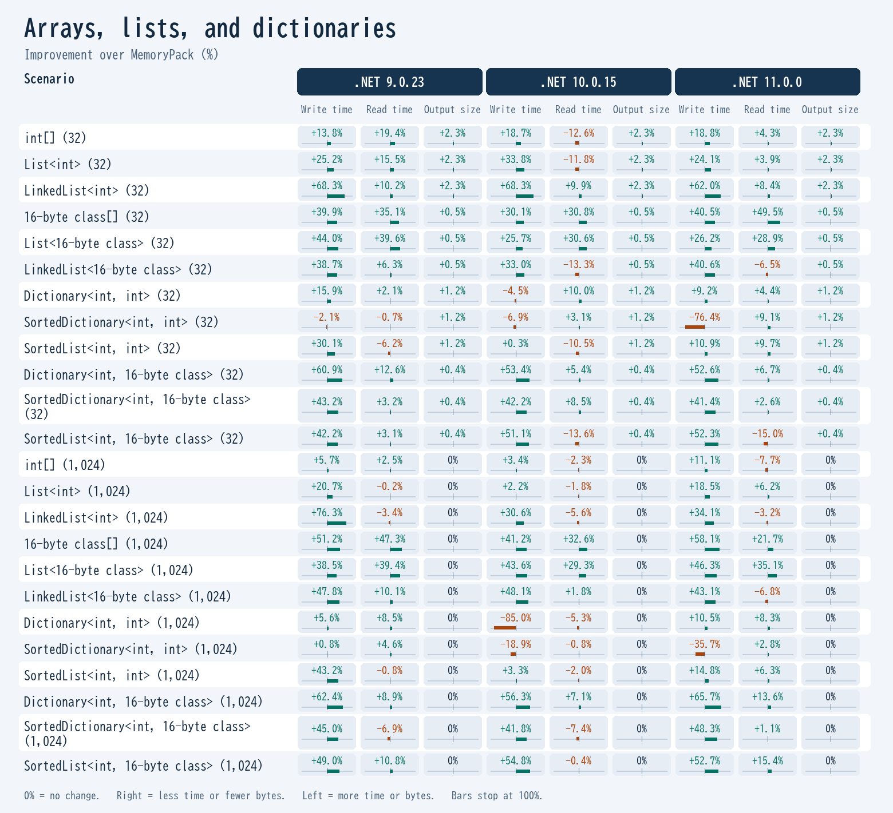

# ApexPack

ApexPack is a binary serializer for .NET.

- [Single-file C# example](docs/examples/QuickStart.cs)
- [Performance and data size charts](docs/performance.md)
- [Wire format](docs/WireFormat.md)

With the .NET 10 SDK or later, run this command from the repository root.

```sh
dotnet run --file docs/examples/QuickStart.cs
```

## Performance and data size charts

Compare all 87 scenarios on .NET 9, 10, and 11. **0% means equal to MemoryPack. A positive value means ApexPack takes less time or produces fewer bytes. A negative value means ApexPack takes more time or produces more bytes.** Write time means serialization. Read time means deserialization.

<details open>
<summary>Basic types and strings</summary>


</details>

<details>
<summary>Inheritance and nested objects</summary>


</details>

<details>
<summary>Large payloads and .NET 11 features</summary>


</details>

<details>
<summary>Value types and reference types</summary>


</details>

<details>
<summary>Arrays, lists, and dictionaries</summary>



</details>

<details>
<summary>Trees, shared references, and cycles</summary>


</details>

<details>
<summary>Nullable references</summary>


</details>

[Performance and data size charts](docs/performance.md) · [All charts as text tables](docs/benchmark-results.md) · [Raw measurements and memory allocations (CSV)](docs/data/runtime-benchmarks.csv)

<!-- benchmark-results:begin -->
## Selected benchmark measurements

Each cell shows **ApexPack / MemoryPack**. Times and memory allocations are per operation.

| Runtime | Scenario | Write time (ns) | Read time (ns) | Output (bytes) | Write allocation (bytes) | Read allocation (bytes) |
| --- | --- | ---: | ---: | ---: | ---: | ---: |
| .NET 9.0.23 | `LinkedList<int>` (1,024 items) | 1,893.4 / 7,976.8 | 10,240.4 / 9,905.4 | 4,099 / 4,100 | 4,128 / 4,128 | 49,192 / 49,192 |
| .NET 9.0.23 | `SortedDictionary<int, int>` (1,024 entries) | 8,435.5 / 8,505.7 | 43,052.3 / 45,134.8 | 8,195 / 8,196 | 8,440 / 8,440 | 49,264 / 49,264 |
| .NET 9.0.23 | Shared references (1,000 nodes) | 48,200.0 / 15,652,900.0 | 35,033.3 / 62,833.3 | 13,496 / 29,477 | 13,520 / 127,705,320 | 80,000 / 80,000 |
| .NET 9.0.23 | Cycle (1,000 nodes) | 26,866.7 / 8,777,366.7 | 30,600.0 / 51,366.7 | 11,001 / 26,734 | 11,032 / 127,702,576 | 80,000 / 80,000 |
| .NET 9.0.23 | Required string, all values present | 9,899.6 / 14,589.8 | 13,609.2 / 20,868.0 | 10,243 / 17,412 | 10,272 / 17,440 | 73,752 / 73,752 |
| .NET 9.0.23 | Nullable string, all values present | 10,198.1 / 13,510.5 | 13,830.9 / 20,337.9 | 10,243 / 17,412 | 10,272 / 17,440 | 73,752 / 73,752 |
| .NET 9.0.23 | Required child object, all values present | 8,456.0 / 15,485.3 | 13,447.9 / 20,187.4 | 17,411 / 18,436 | 17,440 / 18,464 | 65,560 / 65,560 |
| .NET 9.0.23 | Nullable child object, all values present | 9,464.2 / 14,397.8 | 13,358.9 / 19,614.1 | 17,411 / 18,436 | 17,440 / 18,464 | 65,560 / 65,560 |
| .NET 10.0.15 | `LinkedList<int>` (1,024 items) | 4,302.8 / 6,198.8 | 11,356.7 / 10,758.9 | 4,099 / 4,100 | 4,128 / 4,128 | 49,192 / 49,192 |
| .NET 10.0.15 | `SortedDictionary<int, int>` (1,024 entries) | 6,999.1 / 5,886.7 | 33,699.5 / 33,428.9 | 8,195 / 8,196 | 8,440 / 8,440 | 49,264 / 49,264 |
| .NET 10.0.15 | Shared references (1,000 nodes) | 41,250.0 / 10,359,850.0 | 41,050.0 / 66,500.0 | 13,496 / 29,477 | 13,520 / 127,705,320 | 80,000 / 80,000 |
| .NET 10.0.15 | Cycle (1,000 nodes) | 24,600.0 / 15,868,875.0 | 29,050.0 / 50,700.0 | 11,001 / 26,734 | 11,032 / 127,702,576 | 80,000 / 80,000 |
| .NET 10.0.15 | Required string, all values present | 9,260.9 / 13,182.0 | 13,311.6 / 19,830.1 | 10,243 / 17,412 | 10,272 / 17,440 | 73,752 / 73,752 |
| .NET 10.0.15 | Nullable string, all values present | 9,399.9 / 12,553.7 | 12,812.7 / 22,017.3 | 10,243 / 17,412 | 10,272 / 17,440 | 73,752 / 73,752 |
| .NET 10.0.15 | Required child object, all values present | 7,129.8 / 12,958.4 | 10,895.9 / 17,695.9 | 17,411 / 18,436 | 17,440 / 18,464 | 65,560 / 65,560 |
| .NET 10.0.15 | Nullable child object, all values present | 6,872.7 / 11,992.5 | 11,046.3 / 16,443.5 | 17,411 / 18,436 | 17,440 / 18,464 | 65,560 / 65,560 |
| .NET 11.0.0 | `LinkedList<int>` (1,024 items) | 3,821.2 / 5,798.9 | 10,005.2 / 9,694.4 | 4,099 / 4,100 | 4,128 / 4,128 | 49,192 / 49,192 |
| .NET 11.0.0 | `SortedDictionary<int, int>` (1,024 entries) | 10,080.8 / 7,426.5 | 49,371.3 / 50,808.8 | 8,195 / 8,196 | 8,440 / 8,440 | 49,264 / 49,264 |
| .NET 11.0.0 | Shared references (1,000 nodes) | 39,200.0 / 15,540,300.0 | 336,266.7 / 321,633.3 | 13,496 / 29,477 | 13,520 / 127,705,320 | 80,000 / 80,000 |
| .NET 11.0.0 | Cycle (1,000 nodes) | 25,400.0 / 8,613,466.7 | 228,966.7 / 236,833.3 | 11,001 / 26,734 | 11,032 / 127,702,576 | 80,000 / 80,000 |
| .NET 11.0.0 | Required string, all values present | 8,478.2 / 12,442.0 | 12,225.3 / 17,953.8 | 10,243 / 17,412 | 10,272 / 17,440 | 73,752 / 73,752 |
| .NET 11.0.0 | Nullable string, all values present | 8,779.2 / 12,214.7 | 12,124.3 / 19,887.4 | 10,243 / 17,412 | 10,272 / 17,440 | 73,752 / 73,752 |
| .NET 11.0.0 | Required child object, all values present | 6,783.7 / 12,081.1 | 10,240.6 / 17,052.5 | 17,411 / 18,436 | 17,440 / 18,464 | 65,560 / 65,560 |
| .NET 11.0.0 | Nullable child object, all values present | 7,405.3 / 12,518.1 | 9,853.0 / 16,053.8 | 17,411 / 18,436 | 17,440 / 18,464 | 65,560 / 65,560 |

[All raw measurements (CSV)](docs/data/runtime-benchmarks.csv) · [How the benchmarks were run](docs/performance.md#how-the-benchmarks-were-run)
<!-- benchmark-results:end -->

## Publish the documentation

In the GitHub repository, open **Settings → Pages → Build and deployment → Source** and select **GitHub Actions**. The documentation workflow checks the example, builds the site with Docfx, and publishes it to GitHub Pages when you push to the default branch. You can also run it from the Actions tab. [Documentation workflow](.github/workflows/docs.yml)

To preview the site locally, run these commands with the .NET 10 SDK or later. The generated site is in `docs/_site`.

```sh
dotnet tool install --global docfx --version 2.81.0
docfx build docs/docfx.json --serve
```
