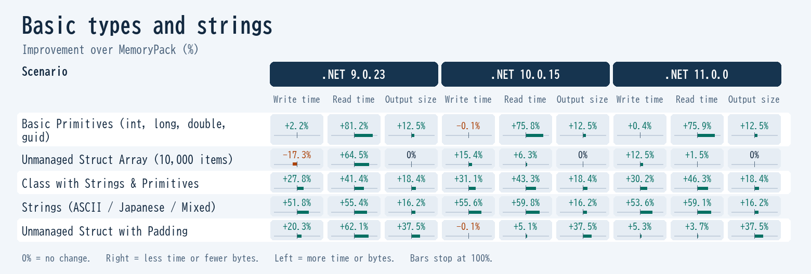
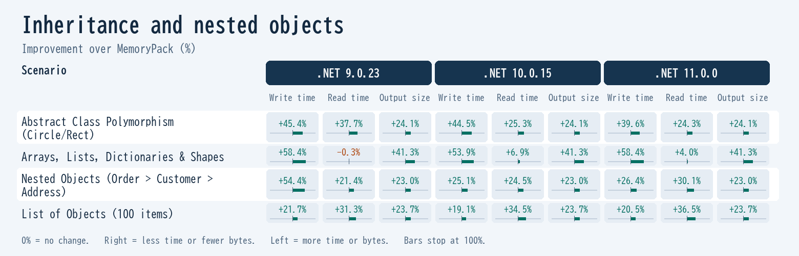
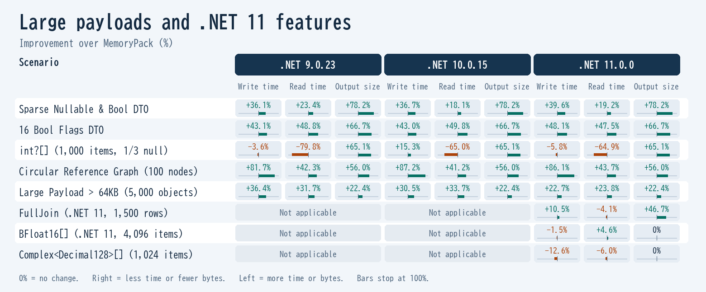
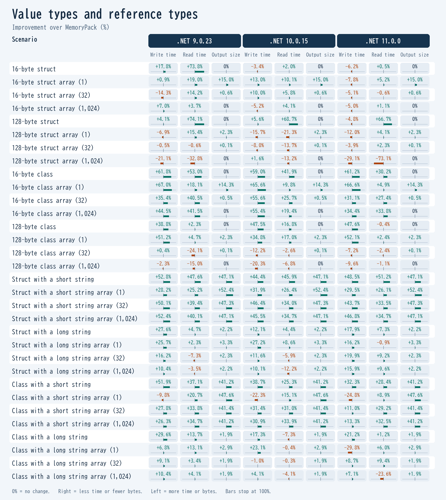
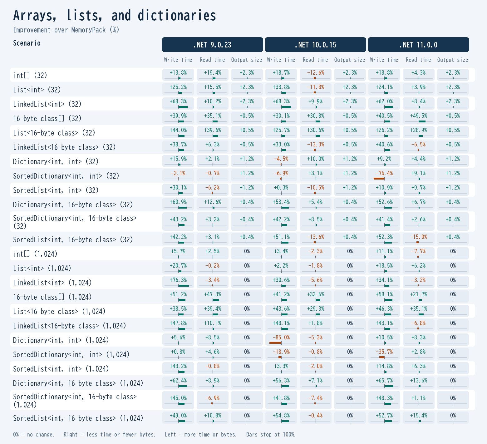
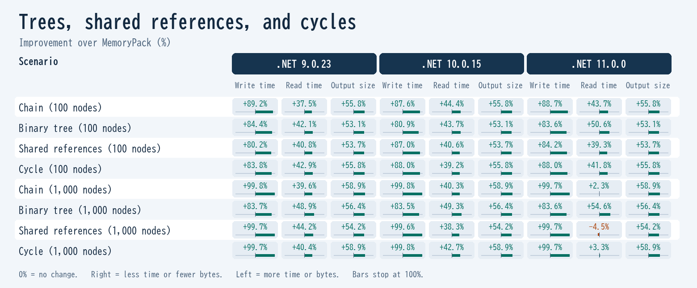
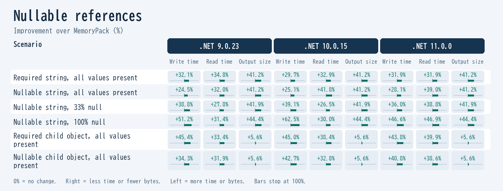
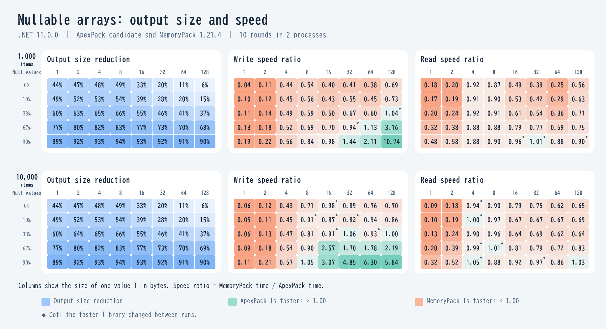

# Performance and data size charts

These charts compare ApexPack with MemoryPack across 87 scenarios on .NET 9, 10, and 11. Each row shows one scenario. Each runtime has three columns: write time, read time, and output size.

- **Positive:** ApexPack takes less time or produces fewer bytes.
- **Negative:** ApexPack takes more time or produces more bytes.
- **Zero:** The values are equal at the displayed precision.

For example, **+25%** in write time means ApexPack takes 25% less time to serialize the same input. Write time means serialization. Read time means deserialization. Bars stop at 100%. The labels show the full percentage.

[All charts as text tables](benchmark-results.md) · [Raw measurements and memory allocations (CSV)](data/runtime-benchmarks.csv)

## Basic types and strings

[](images/runtime-benchmarks-basics.png)

## Inheritance and nested objects

[](images/runtime-benchmarks-models.png)

## Large payloads and .NET 11 features

[](images/runtime-benchmarks-large.png)

## Value types and reference types

[](images/runtime-benchmarks-shapes.png)

## Arrays, lists, and dictionaries

[](images/runtime-benchmarks-collections.png)

## Trees, shared references, and cycles

[](images/runtime-benchmarks-graphs.png)

## Nullable references

[](images/runtime-benchmarks-nullability.png)

## How the benchmarks were run

The measurements are from November 25, 2026. All runs used the same Windows x64 host, a Release build, and MemoryPack 1.21.4. The study covers 84 scenarios on .NET 9.0.23, 84 on .NET 10.0.15, and 87 on .NET 11.0.0. Each reported time is the median of 11 rounds. The run order alternates between the libraries.

Most processes measured up to eight scenarios and used a 384 MiB GC heap limit. Each graph with 1,000 nodes ran in its own process with a 1 GiB heap limit and `DOTNET_GCConserveMemory=9`. Both libraries used the same settings for each scenario on all three runtimes. Memory allocation is the average over 64 operations on the measuring thread after warm-up.

To run the benchmarks, select `net9.0`, `net10.0`, or `net11.0`. For example, from the repository root:

```sh
dotnet run --project benchmarks/ApexPack.Benchmarks -c Release -f net11.0 -- --json benchmark-net11.json
```

Use `--verify benchmark-payload-net11.json` to check round trips and save output sizes and memory allocations without timing the operations.

To update the README table and raw data, pass the new comparison CSV to `tools/UpdateBenchmarkReadme.ps1`. On Windows with Pillow installed, run `python tools/generate_benchmark_infographics.py` to update the seven charts and the text tables.

## Nullable array study

For arrays of fixed-size nullable values, ApexPack stores a bitmap and the values that are present. MemoryPack copies the memory layout for every element, including null elements. This study varies the element size and the share of null values to show how those choices affect time and output size. [ApexPack wire format](WireFormat.md)

[](images/nullable-array-tradeoff.png)

The speed ratio in this chart is **MemoryPack time divided by ApexPack time**. Above 1.00 means ApexPack is faster. Below 1.00 means MemoryPack is faster. A dot marks a case where the faster library changed between the two runs.

| Items | Element size | Null values | Output size reduction | Write speed ratio | Read speed ratio |
| ---: | ---: | ---: | ---: | ---: | ---: |
| 1,000 | 1 B | 33% | 60% | 0.11 | 0.19 |
| 10,000 | 16 B | 67% | 77% | 2.51 | 0.78 |
| 1,000 | 128 B | 90% | 90% | 6.56 | 0.90 |

[](images/nullable-array-absolute.png)

The horizontal axis shows the size of one value in bytes. Each step doubles that size. The vertical axis uses a logarithmic scale and shows output size in KiB or time in microseconds per array. The times include allocating the array returned by the API.

This separate study used .NET 11.0.0 and MemoryPack 1.21.4 on Windows x64 with an Intel Core i7-14700F on November 16, 2026. It tested 1,000 and 10,000 items, eight value sizes from 1 to 128 bytes, and five percentages of null values from 0% to 90%. Each of the 80 conditions ran five rounds in each of two processes. The study verified the output sizes and decoded values for every condition. [All 80 conditions (CSV)](data/nullable-array-benchmarks.csv)
