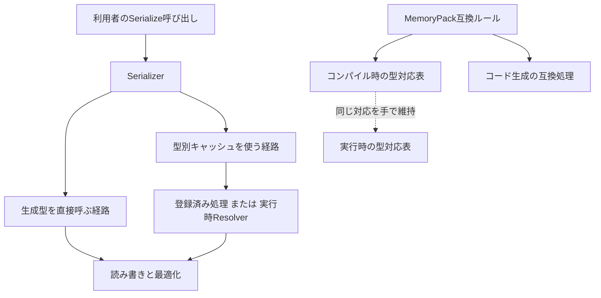
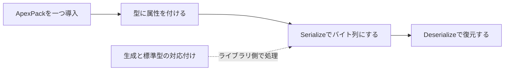
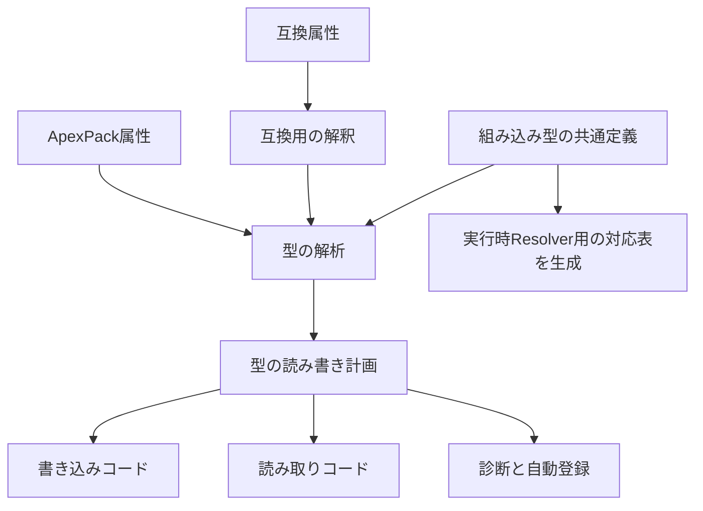
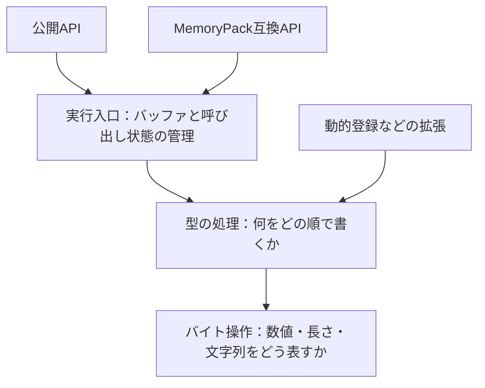
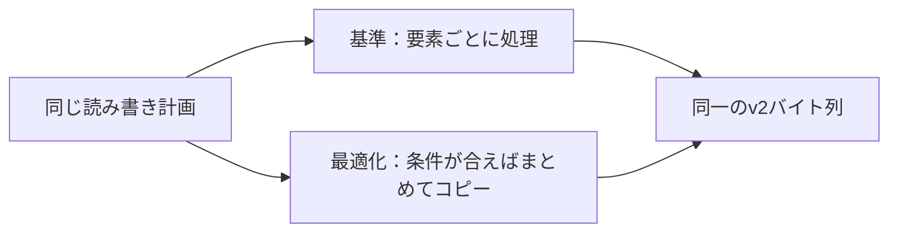
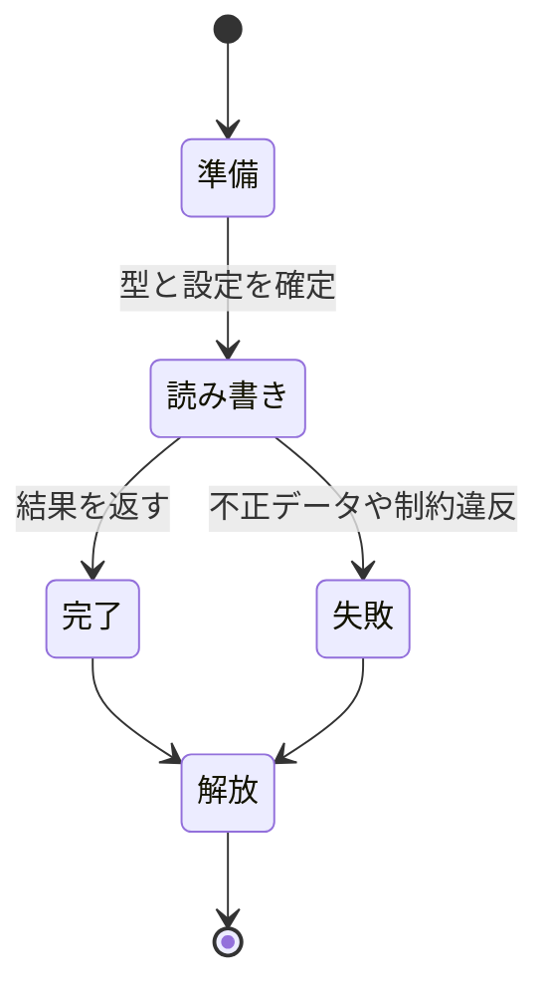

# ApexPackを簡単に使い、簡潔に保守するアーキテクチャー案

## 背景

2026-11-16の作業ツリーを調査した設計提案。未コミット変更を含む現在のコードを対象にし、製品コードは変更していない。MemoryPackを参考にした開発経緯そのものは断定しない。ただし、MemoryPack互換API、属性の読み替え、公式テストの取り込みは実装から確認できる。

利用者にとっての成功は「導入し、型に属性を付け、保存・復元するまでに内部の仕組みを覚えなくてよいこと」。開発者にとっての成功は「型を一つ追加するときに、対応表や形式の判断を何か所も手で直さなくてよいこと」。短いAPI名やファイル数だけを成功指標にしない。

## 現状の観察

以下はコードと文書で確認したFact。実行試験での再確認は今回行っていない。

| 観察 | 根拠 |
| --- | --- |
| 属性とSerialize/Deserializeによる簡単な入口は既にある | `src/ApexPack.Core/Attributes/ApexAttributes.cs`、`ApexPackSerializer.cs` |
| 生成型の直接呼び出しと、型別キャッシュ経由の呼び出しがある | `ApexPackSerializer.cs`、`ISerializePackable.cs`、`Formatters/IApexFormatter.cs` |
| コンパイル時と実行時の型対応を別々に管理している | `TypeAnalyzer.cs`冒頭のコメント、`ApexFormatterResolver.cs`の対応表 |
| 型の解析結果を保持するTypeModelは既にある | `src/ApexPack.Generator/TypeModel.cs` |
| 互換パッケージは既に分かれているが、生成器には互換固有の判断がある | `TypeAnalyzer.CompatAlias`、`CodeEmitter.EmitCompatCallbackWrappers` |
| バイト形式はApexPack独自のv2で、MemoryPack形式とは互換ではない | `docs/WireFormat.md` |
| 宣言順、nullability、Unionタグなどがバイト形式に関係する | 同上 |
| バージョン耐性は未対応 | `ApexAttributes.cs`のVersioning、`TypeModel.cs`のUnsupported |
| アンロード可能性を守る設計と対照試験がある | `ApexFormatterRegistry.cs`、`UnloadabilityTests.cs` |
| 登録済み生成コードをAOTに使う設計だが、任意の型のAOT動作を今回検証したわけではない | `ApexPackGenerator.cs`、`ApexFormatterResolver.cs` |



複数の経路そのものを欠陥とは扱わない。高速化・動的利用に必要な経路を残しつつ、同じ仕様判断の重複を減らすことを狙う。

## 過去設計から引き継ぐ仕様

調査時点で既存の `docs/refactoring-designs/` はなかった。現行の `docs/WireFormat.md` と関連テストを引き継ぐ。

- v2のバイト形式、固定幅LE、パディングを含めない表現。
- null、空、非null制約を区別する規則。
- 参照保持が有効な範囲の共有・循環参照。
- 呼び出し単位の安全上限と参照追跡状態。
- プラグインの型をグローバルな強参照で保持しない。
- MemoryPack互換APIとMemoryPackのバイト互換を混同しない。
- 既存公開APIと、明示的な動的登録・Unionの利用経路。

## 目的

1. 通常利用では、導入するパッケージを一つ、基本操作をSerialize/Deserializeにする。
2. 組み込み型の対応ルールを一か所で管理する。
3. 通常の生成処理からMemoryPack固有の解釈を切り離す。
4. 最適化の有無で保存形式が変わらない構造にする。
5. 利用者に登録漏れや非対応機能をできるだけビルド時に知らせる。

## 非目的

今回は設計案のみ。実装、性能向上の保証、全型のNativeAOT対応の保証はしない。
新しい保存形式、スキーマ進化、圧縮・暗号化、ファイル保存サービス、全オブジェクトの自動循環参照対応は追加しない。
既存の高速経路や低レベルAPIを一括削除しない。

## 提案設計

### 原理の異なる三案

| 案 | 仕組み | 簡単になる点 | 反証・弱点 |
| --- | --- | --- | --- |
| A: 実行時解釈 | 型を実行時に調べ、共通処理がメンバーを読み書きする | 生成器を減らせる。利用者の属性を減らす余地もある | 大量データ・小さい型の反復では処理負荷が課題。AOT/privateアクセス/トリミングを扱うと別の複雑さが増す |
| B: 生成中心の一本化 | 型対応の正本と型ごとの計画から、専用の読み書きを生成する | 通常の高速利用を維持し、重複する仕様判断を減らす | 生成器は残る。実行時しか分からない型やジェネリックには明示した拡張経路が必要 |
| C: スキーマ中心 | C#とは別のID付きスキーマから型と読み書きを生成する | 型変更の互換管理や他言語対応を統一しやすい | スキーマ管理という利用者の仕事が増える。v2保存形式の移行を伴う可能性が高い |

**推奨はB。** 現在の強みと保存形式を活かしつつ、保守時の二重管理に直接対処できる。
速度より動的な任意型対応が最優先ならA、長期保存のスキーマ進化や他言語通信が最優先ならCへ判断を変える。

### 利用者に見える形

提案する統合パッケージ `ApexPack` は、CoreとGeneratorを適切な依存・Analyzer配置でまとめる。これは提案であり、公開済みNuGetパッケージの存在を示すものではない。



基本コードは現在の形を維持する。利用者に新しいAPI名を覚えさせない。

```csharp
[ApexPackable]
public partial class SaveData
{
    public int Level { get; set; }
    public string Name { get; set; } = "";
}

byte[] bytes = ApexPackSerializer.Serialize(data);
SaveData restored = ApexPackSerializer.Deserialize<SaveData>(bytes);
```

利用者が意識するのは例外的な要求だけ。循環・共有参照を保存するなら既存の `PreserveReferences`、外部からの入力なら既存の `DeserializeSafe` を使う。通常の `Deserialize` が安全上限付きへ変わったとは説明しない。Unionの識別タグと外部型の独自変換は明示的に指定する。

### 中心概念は「型の読み書き計画」

新たな汎用フレームワークを作るのではなく、既存のTypeModelを整理する。



組み込み型の共通定義は、メタデータ名、型引数数、使用するフォーマッタ、固定幅などの宣言的な表。Roslynの型や実行時のTypeを直接保存する表にはしない。この表からビルド時に両環境用の対応コードを生成し、CoreをRoslynへ依存させない。

型ごとの計画は、メンバー順、null位置、固定幅、構築方法、参照保持条件を持つ。書き込みと読み取りは同じ計画から派生する。実行中にこの計画を一項目ずつ解釈する仕組みにはしない。型の再帰は訪問中・確定済みを区別し、必要な特性は循環を含む型グラフ上で確定する。

正本の役割は分ける。バイト形式の契約はWireFormatと固定バイト試験、組み込み型の対応は共通定義、利用者の型構造はC#宣言。生成コードやResolver表は派生物であり手編集しない。

### 内部は三つの責務に整理する



型の処理は論理的にWrite/Readを中心とし、固定幅・一括コピー可能性などは計画由来の任意の能力情報にする。現在のstatic abstract契約を、無条件に仮想メソッド二つへ置き換える案ではない。追跡器や安全ガードのジェネリック特殊化も、性能確認前に捨てない。

既存の `ISerializePackable<T>` と `IApexFormatter<T>` の接続は、共通テンプレートで生成する薄い橋渡しに寄せる。現状の `FormatterAdapter` を活かし、型ごとの保存形式や安全判断を橋渡しへ重複実装しない。高速な直接経路と動的経路は、同じ計画に従う。

MemoryPack互換パッケージは既に存在するため、追加分割それ自体を改善と数えない。生成器の互換属性解釈とコールバック用ラッパーを専用部分へ移し、通常のコード出力からMemoryPack固有分岐を減らす。コールバックの順番・前後のデータ塊など、現行契約は維持する。

### 高速化は同じ結果を作る別経路にする



独立した新しい汎用最適化エンジンは作らない。既存の固定幅、一括コピー、Nullable配列などの規則を、小さな生成処理・バイト操作に閉じ込める。検証できないレイアウトは基準経路で処理する。速さの比較前に、出力バイト一致、境界検査、読み取り結果を一致させる。

### 型の発見と登録の限界

通常の属性付き型は生成と登録を自動化する。ただし「型の宣言さえあれば、あらゆるジェネリックの閉じた型をAOTで自動発見できる」とはしない。

- 生成対象から到達できる型と、静的に特定できるルートを扱う。
- 実行時にしか決まらない型・プラグインは既存の動的拡張に委ねる。
- AOTで静的に列挙できないルートには、必要な型を指定する仕組みを別途設ける。具体APIは試作で決める。
- 通常の静的利用で発見できる非対応型・機能はビルド診断にする。動的経路の失敗は型と理由が分かる例外にする。
- 互換層の既存の「実行時に非対応例外を返す」契約は、ネイティブAPI側の診断改善と分離して維持する。

### 状態と失敗の扱い



参照表・深さ・要素数カウンター・借用バッファは一呼び出しが所有し、成功・例外のどちらでも解放する。再入・並行呼び出しに状態を共有しない。Type別キャッシュはコードと不変の能力情報だけを保持し、アプリの値を保持しない。

Deserializeは成功時だけ結果を返す。ただし利用者のコンストラクタやコールバックの外部副作用はロールバックしない。SpanやStreamへの書き込みは途中で失敗すると部分出力が残り得る。汎用的なトランザクション保証を付けない。

## 影響範囲

| 対象 | 変更方針 |
| --- | --- |
| Generator/TypeAnalyzer、Core/ApexFormatterResolver | 組み込み型の対応定義を共有し、各表を生成する |
| Generator/TypeModel、CodeEmitter | 形式の計画、生成、互換ラッパー、最適化判定の責務を分ける |
| ISerializePackable、IApexFormatter、Serializer | 公開互換を保ち、橋渡しと共通入口の重複を徐々に減らす |
| MemoryPackCompat | 現行のAPI互換範囲を維持。通常Coreからの逆依存を作らない |
| パッケージ構成 | CoreとGeneratorをまとめる導入用パッケージを追加する提案 |
| tests、benchmarks | 固定バイト・経路間同等性・性能・アンロードで移行を確認 |

## 移行手順


1. 実装開始時に未コミット作業との境界を確定し、現行候補のバイト・API・性能を保存する。
2. 組み込み型の対応表だけを共通化する。保存形式とAPIは変えない。
3. 互換の解釈とラッパーを分ける。公式取り込みテストを改変しない。
4. TypeModelを整理し、一種類の代表型でコード生成と橋渡しを試作する。性能悪化ならこの段階を戻し、前段の改善は残す。
5. 対象を広げ、導入用パッケージと診断を追加する。既存利用コードがそのまま動くことを確認する。

新旧でバイトが違った場合は移行を止める。v2はバージョンヘッダーを持たないため、自動判別や黙った形式変更はしない。バージョン耐性を別途追加する場合は、識別できる別形式として新しい設計判断を行う。

## テスト計画

設計文書だけの今回は内容と参照先を確認し、ビルド・製品テストはNotRun。既存テストの存在は合格実績の代用にしない。

実装時は変更箇所に近い代表試験から始める。

| 観点 | 既存の入口・追加すべき確認 |
| --- | --- |
| v2の形式維持 | WireFormatTests、EndiannessTests、PaddedLayoutTests、NullableSequenceTests。旧候補との固定バイト比較 |
| 経路の一致 | 直接生成・キャッシュ・Type指定・Span・IBufferWriterで同じバイトと消費数 |
| 生成 | GeneratorCoverageTests。代表入力の生成・コンパイル・実行と再生成一致 |
| 参照と安全性 | CircularReferenceTest、SecurityDefenseTests。循環、共有、切断入力、過大件数、深さ上限 |
| 拡張と寿命 | RuntimeRegistrationTests、UnloadabilityTests。遅延ロード、再入、並列、破棄後の型回収 |
| 互換 | 固定したMemoryPack版の上流比較。形式差・対象外・仕様差・失敗を分離 |
| AOT | 明示した対応ルートの最小publishと実行。未検証の閉じた型まで成功と一般化しない |
| 性能 | 固定幅struct、文字列付きclass、大きな配列、Nullable列、参照グラフ。初回と暖機後、割当量、生成コード量を別々に測る |
| 利用者体験 | 新規サンプルで統合パッケージだけから導入し、通常型の手動登録が不要であること |

性能の受入値は未合意。試作の仮目標は、同一条件の反復測定で代表ケースの暖機後の中央値の悪化5%以内、単純ケースの割当量増加なし。測定ばらつきが大きい場合は判定不能として条件を整える。全ケース平均だけで重要ケースの悪化を隠さない。

## リスクと対策

- **抽象化の追加でかえって大きくなる**: 新機構は既存の重複を置き換える場合だけ採用。TypeModelに並ぶ別の全能モデルを作らない。
- **実行時分岐が増えて遅くなる**: 計画はビルド時に解決し、staticな直接呼び出しを維持。性能確認前にtracker/guardの特殊化を消さない。
- **コレクションを共通化して順序や比較器が壊れる**: 共通化するのは読み書きの規則。Stackの復元順や型固有の構築は各実装に残す。
- **グローバル登録でプラグインを解放できなくなる**: 現行の型別キャッシュ・弱参照方針を維持し、負の対照を含むアンロード試験で確認。
- **互換層を分けて既存利用が壊れる**: 移行中は既存パッケージと公開シンボルを維持し、互換生成の出力契約も固定する。
- **APIが簡単なため長期保存にも自動で強いと思われる**: メンバー順やnullabilityの変更でv2契約が変わることを利用説明に明記。今回の簡潔化では解決しない。

## 未決事項

設計案を提示する段階では以下を質問せず、保守的な仮定で整理した。

- 既存v2バイトと公開APIの互換を維持する前提。互換を捨ててよい場合はさらに別案を評価できる。
- 任意の実行時型や全MemoryPack機能への追従を、標準利用の必須条件にはしない。
- AOTで明示するルート型の宣言APIと対応範囲は、代表試作で確定する。
- 統合パッケージの配布先・既存パッケージ移行方針は配布作業前に確定する。
- 性能の正式な受入閾値は合意していない。

## 実装担当への契約

初回の実装範囲は「組み込み型対応の一元化」とその生成物・代表試験に限定する。共有定義はRoslynやCoreの型に直接依存しない宣言データとし、生成時と実行時の対応表を派生させる。v2形式、登録のタイミング、既存公開シンボルを変えない。TypeModelの大幅変更や既定の安全設定変更を混ぜない。

通常経路に実行時のメンバー走査を追加しない。非対応を無視しない。生成処理の失敗を空の成功結果にしない。状態は呼び出し単位とし、失敗時も借用資源を返す。文書・生成コード・固定バイト試験が矛盾したら、その段階で止めて原因を特定する。

## 合意状態

**提案・未合意・未実装。** ユーザーの依頼はアーキテクチャー案と図を使った説明。実装へ進む合意は取得していない。既存コード・通常仕様書・取り込みテストは変更していない。

参考: [MemoryPack公式リポジトリ](https://github.com/Cysharp/MemoryPack)。公式の基本利用、ソース生成、属性の説明を参照。ローカル上流テストの版と取得情報は `tests/MemoryPack.Upstream/UPSTREAM.md` を正とする。
